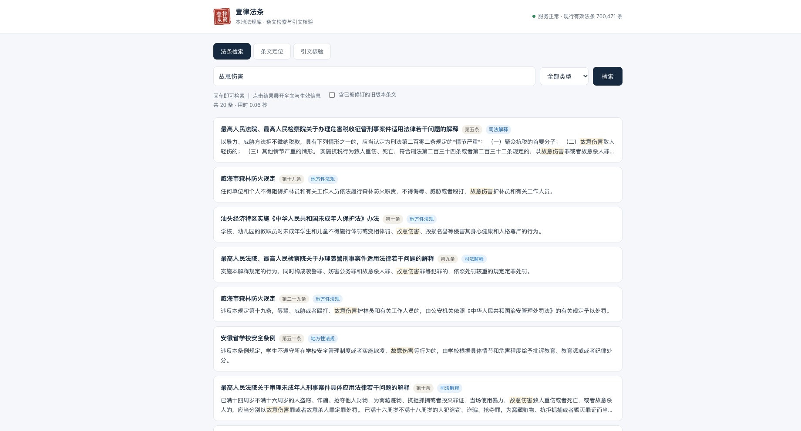
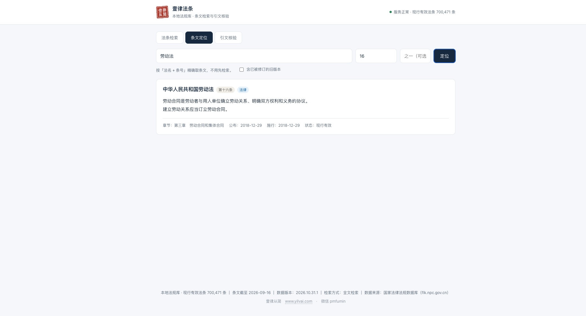
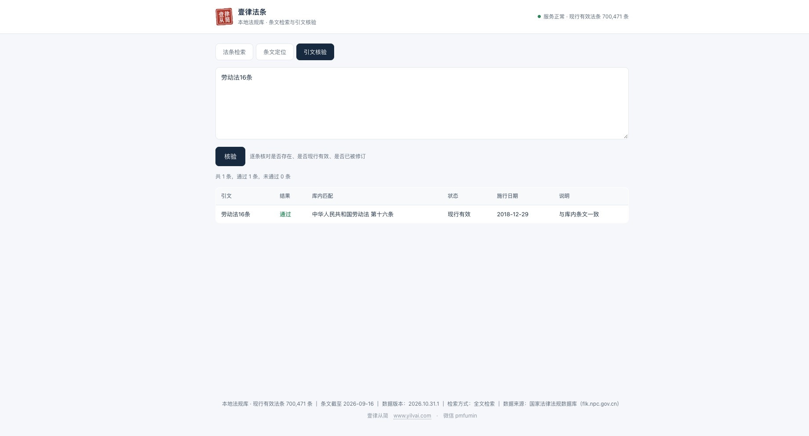

# 壹律法条 · China Law Search

把国家法律法规数据库（flk.npc.gov.cn）的条文落到本地，用一个 SQLite 文件 + 一个 FastAPI 服务，
给律师和法务提供**可离线、可自建、可增量更新**的法条检索与引文核验能力。

**代码在这里，数据在 Release。** 全量库解压后 2.3 GB，不进 git，
用 `tools/fetch_data.py` 一条命令下载。

> **不想折腾命令行？** 把 [`INSTALL.md`](INSTALL.md) 第一节里那段话整段复制给你的 AI
> （WorkBuddy / Claude / ChatGPT / Trae 都行），它会自己检查环境、下载、装好、跑通验证，
> 最后把本地查询页面打开。你只需要在最后点一次「信任」。

四种用法，按需要选：

- **本地查询界面**：双击启动脚本，浏览器打开就能搜法条、按条号定位、批量核验引文。
  完全离线，最贴近律师日常用法。
- **接进 agent（MCP）**：WorkBuddy、Trae、ZCode、Claude Code 等直接查法条，
  用条文支撑结论前自动核验真假与时效。**零第三方依赖**，是最快让 AI 会查法条的方式。
- **HTTP API**：接进自己的办案系统、文书工具、AI 工作流。
- **自建数据库**：用内置流水线把官方 Markdown 解析入库，或按增量包持续更新。

## 能力

| 能力 | 说明 |
|---|---|
| 法条检索 | 关键词检索，FTS5 全文索引 + bm25 相关性排序；装向量库后可切换语义检索 |
| 条文定位 | 按「法律名称 + 条号」直接取条文，支持「第八十二条之一」这类增补条 |
| 引文核验 | 批量提交引文，逐条核对是否存在、是否现行有效、是否已被修订、是否原则性条款 |
| agent 接入 | 内置 MCP 服务器（stdio，零第三方依赖），四个只读工具，见 [`mcp/README.md`](mcp/README.md) |
| 版本保留 | 被修订的旧条文不删除，标记为已失效；默认不返回，需要时显式开启 |
| 增量更新 | 下载新版 Word/Markdown → 生成变更报告 → 人工确认 → 写库，全程可审计 |
| 离线运行 | 检索不依赖任何外部接口，内网、无网环境可用 |

## 快速开始

> 下文命令写作 `python3`。Windows 上如果提示找不到该命令，换成 `python`。

### 一、接进 agent（不需装任何依赖）

```bash
git clone https://github.com/tlgzs/china-law-search.git
cd china-law-search
python3 tools/fetch_data.py            # 下载数据包并校验
python3 mcp/install.py --all --yes     # 写入本机 agent 配置
```

MCP 服务器只用 Python 标准库，**不需要 `pip install` 任何东西**，
macOS 自带的 Python 3.9 就能跑。装完在 WorkBuddy 的连接器页点「信任」，
Trae / Cursor 重启客户端即生效。四个工具的用法见 [`mcp/README.md`](mcp/README.md)。

跑通验证：

```bash
python3 mcp/server.py --selftest
```

### 二、本地查询界面

需要三个 Web 依赖（`fastapi` / `uvicorn` / `pydantic`）。装数据之后直接双击：

```
启动.command     # macOS
启动.bat         # Windows
```

脚本会自动建虚拟环境、装依赖、等服务就绪再打开 `http://127.0.0.1:8001`
（端口被占用会顺延到 8010 之间）。命令行用 `./start.sh` 效果一致。

也可以手动起：`python3 -m uvicorn server.law_search_service:app --port 8001`。

打开后三个页签，分别对应「只记得关键词」「已知道条号」「手里有引文要核」三种场景。
检索框支持 `⌘K` / `Ctrl+K` 聚焦，首屏有八个常用查询点击即搜，底部显示当前数据版本。
服务默认只听 `127.0.0.1`，同一局域网的其他机器连不上。

详细用法见 [`INSTALL.md`](INSTALL.md) 第五节。

语义检索是**可选**的，要另装 `requirements-vector.txt`（会连带 torch，2 GB 以上）。
不装照样能用：服务检测不到向量库时自动降级为 FTS5 全文检索，
检索、条文定位、引文核验三项功能都不受影响。

### 三、Docker

```bash
docker compose up -d
```

数据目录 `./data` 挂载进容器，先跑一次 `python3 tools/fetch_data.py`，或把下载好的库放进去。

### 数据不在仓库里

全量库解压后 2.3 GB，超过 git 单文件上限，所以**仓库只放代码，数据走 Release**。
`tools/fetch_data.py` 一条命令完成下载、校验、解压、就位：

```bash
python3 tools/fetch_data.py            # 没库就下全量；有库则比对版本，有新才下
python3 tools/fetch_data.py --check    # 只看版本，不下载
python3 tools/fetch_data.py --full     # 强制重下全量
```

下载的东西不会被盲目覆盖：先解压到临时文件，校验 sha256 与数据库完整性，
通过后才替换，旧库留一份 `.bak`。

**网络下不动 GitHub 时**，用浏览器手动下载 Release 附件，再：

```bash
python3 tools/fetch_data.py --from-file 下载到的 law_data-xxx.db.zst
```

`--from-file` 也认 `.gz`。两种格式内容一致，`.gz` 略大但解压不需要额外装任何东西。

**直接下 ZIP 包（没用 `git clone`）的人要注意**：解压出来的目录里没有 `.git`，
`fetch_data.py` 猜不到该从哪个仓库下载，会直接报错退出。显式指定即可：

```bash
python3 tools/fetch_data.py --repo tlgzs/china-law-search
```

以后自己 fork 过、想从上游取数据时也用同一个参数。

## 数据从哪来

法规文本来自**国家法律法规数据库**（`flk.npc.gov.cn`）公开下载的 Markdown 文件，
属官方文件，可自由使用与再分发。

**这个仓库不提供任何自动采集代码**，也不建议任何人对该站点做批量抓取——
站方 `robots.txt` 明确禁止自动化采集。数据包由维护者线下更新后发布，
使用者只从本项目 Release 下载成品。

### 覆盖范围

| 分类 | 现行法规 | 说明 |
|---|---|---|
| 地方性法规 | 15,388 部 | 省级 / 设区的市 / 自治州 / 自治县 / 经济特区 |
| 行政法规 | 585 部 | — |
| 司法解释 | 362 部 | — |
| 法律 | 302 部 | 按库内现行有效版本计，不含已废止的历史文本 |
| 修改决定 | 222 部 | 「关于修改《X》的决定」按修改项收录，与母法分开，避免混进母法检索结果 |
| 法律解释 / 监察法规 / 宪法 | 12 / 2 / 1 部 | — |

合计 **16,874 部法规 / 700,551 条现行条文**，另含 338,408 条历史条文
（标 `repealed` + 失效日期，默认不返回）。

其中 **1,650 条（42 部法规）是「已公布、尚未生效」**，标 `pending`。这些条文可以查、
可以核，但**不能当现行依据引用**——检索结果带琥珀色「尚未生效 · 某日施行」标签，
引文核验会明确拦一句「不得作为现行有效依据引用」。状态由施行日期与当天比较自动判定，
到了施行日会自动转成 `effective`，不需要人工改。

一部法改了但新版还没施行时，新版与旧版在库里**同时存在**：旧版仍是 `effective`，
是此刻该引的文本；新版是 `pending`，到施行日当天旧版才转 `superseded`、条文标
`repealed`。查条文与检索都按「现行 > 已公布未生效 > 历史」取版，同一条文不会
返回两次。

条文收录截至 **2026-10-17**（库内最新一部法规的公布日期）。这个日期由
`corpus_version` 之外的 `data_cutoff` 单独记录——版本号说明「哪天打的包」，
截止日说明「条文收到哪一天」，两者不要混。

**不含以下内容**，因为官方库本身不收录：

- 部门规章（各部委令）
- 地方政府规章（省市政府令）
- 军事法规、党内法规、国际条约

查「建设工程」「食品经营」这类主题时查不到住建部、市场监管总局的规章，是数据源边界，
不是库坏了。判断某个引用能否在这里核验，先看它是不是上述八类之一。

### 增量补丁的来源与核对

2026-07 以后公布的法规，通过第三方镜像 `lawtext/legal-data-docx` 取原件
（其上游仍是国家法律法规数据库），个别「重新公布」文本以中国人大网转载稿为核对基准。

每一部入选法规都要过四关：提取公布 / 施行日期 → 切分条文 → 与库内同名现行版本逐条比对
→ 生成变更报告人工过一遍后才写库。镜像里比库内**更旧**的历史文本一律不采用，
在报告里单列为 `stale`——否则会出现用 2014 版顶掉 2018 版这类静默倒退。

### 版本与校验

数据以 GitHub Release 附件发布，tag 与版本号一致，形如 `data-2026.10.31.1`：

- `law_data-<版本>.db.zst` / `.gz`：全量库，两种压缩格式内容一致
- `delta-<版本>.json.zst` / `.gz`：增量变更集，只含变的法规
- `manifest.json`：版本号、条数、`db_sha256`、各资产的 sha256 与适用版本

每个响应都带 `data_snapshot.corpus_version`，标明这批数据截至哪一版。
**数据是快照，不是实时**：涉及时效敏感的案件，请以官方发布文本复核。

## 本地查询界面

服务启动后打开 `http://127.0.0.1:8001`，三个页签：

- **法条检索**：输入关键词，勾选「含已被修订的旧版本条文」可一并看到历史条文，
  失效版本带红标并排在现行条文之后。检索完成会显示命中数与耗时。
- **条文定位**：填法律名称与条号（`82` 或 `第八十二条` 都认），增补条在第三栏填 `之一`。
- **引文核验**：一行一条引文，例如 `《劳动合同法》第八十二条`，一次核完。
  一行里写并列引文（`第八十二条、第八十七条`）会自动拆成两条分别核，
  不会只核第一条。

界面完全离线，不加载任何外部资源。底部常驻显示**数据版本**——
写进意见书前应该看一眼，心里有数自己引的是哪一版。

三张图依次对应上面三个页签（截图时数据版本 2026.10.31.1）：



*法条检索：命中条数与耗时直接显示，旧版条文可一并调出，带红标排在现行条文之后*



*条文定位：法名 + 条号即可，下方给出章节归属、公布与施行日期、现行状态*



*引文核验：逐条列出是否命中、命中哪一条、现行是否有效、是否与库内条文一致*

## 接入 agent（MCP）

不想复制粘贴，让 agent 自己查。内置一个 MCP 服务器，四个只读工具：

| 工具 | 作用 |
|---|---|
| `get_article` | 法名 + 条号 → 逐字原文（支持「之一」增补条） |
| `get_law` | 法名 → 章节目录 + 版本沿革 + 条文 |
| `search_articles` | 多关键词 → 候选条文（字面匹配，不做语义理解） |
| `verify_citation` | 一段引文 → 是否逐字命中、命中的是否现行版本 |

```bash
python3 mcp/install.py --list              # 看本机装了哪些客户端
python3 mcp/install.py --all --yes         # 写入（默认只预览，加 --yes 才落盘）
python3 mcp/server.py --selftest           # 装完自检
```

安装器覆盖 WorkBuddy、Trae、ZCode、Claude Code、Codex、Cursor、Cline、Windsurf，
自动探测配置位置、备份原文件、合并写入（不动别人已有的 MCP 条目）。

**两个必须知道的前提**：

- 写文件不等于生效。WorkBuddy 要在连接器页点「信任」，Trae / Cursor 要重启，
  这些脚本做不到，逐步说明见 [`mcp/README.md`](mcp/README.md)。
- MCP 直连 SQLite，**不需要先启动服务**——agent 自己拉起子进程，用完即退。
  这也是它只要 Python 标准库、不装 `mcp` SDK 的原因。

## API

服务默认**免认证**（本地自用）。需要对外开放时设 `LAW_API_ENFORCE=1`，
并在 `data/api_keys.json` 配置 token：

```json
{
  "my-app": {
    "token": "换成你的随机串",
    "tier": "private",
    "rate_limit_per_min": 0,
    "rate_limit_per_day": 0
  }
}
```

`tier` 为 `public` 时按 IP 限流，超额返回 `429` 与 `Retry-After`。
注意：开了强制认证却读不到任何 token 时，服务会自动降级为免认证，避免装完打不开。

### `GET /health`

免认证。返回服务状态、法条总数、现行有效条数、向量库是否启用。

### `GET /api/law/search`

| 参数 | 必填 | 说明 |
|---|---|---|
| `q` | 是 | 查询词 |
| `k` | 否 | 返回条数，默认 10，上限 50 |
| `type` | 否 | 法规类型过滤，如 `law`、`administrative_regulation` |
| `include_history` | 否 | `true` 时包含已失效的旧版本条文 |

```bash
curl -G http://127.0.0.1:8001/api/law/search \
  --data-urlencode "q=未签书面劳动合同" \
  --data-urlencode "k=5"
```

检索走三级策略，逐级保底：

1. FTS5 trigram 全文索引，bm25 排序；
2. 字面包含匹配；
3. 把查询拆成两字片段，命中多数片段即召回（中文不靠分词也能兜住改写）。

返回的 `engine` 字段标明实际走的路径，`items[].score` 为 0~1 的相关度。

### `GET /api/law/article`

| 参数 | 必填 | 说明 |
|---|---|---|
| `law_name` | 是 | 法律名称，支持简称模糊匹配 |
| `article_num` | 是 | 条号数字 |
| `article_suffix` | 否 | 增补条后缀，如 `之一` |
| `include_history` | 否 | 是否返回已失效版本 |

```bash
curl -G http://127.0.0.1:8001/api/law/article \
  --data-urlencode "law_name=劳动合同法" \
  --data-urlencode "article_num=82"
```

### `POST /api/law/verify`

```bash
curl -X POST http://127.0.0.1:8001/api/law/verify \
  -H "Content-Type: application/json" \
  -d '{"citations": ["《劳动合同法》第八十二条", "刑法第一百三十三条之一"]}'
```

每条结果包含 `verified`、`status`、`effective_date`、`repeal_date`、`replaced_by`、
`is_principle_clause`、`has_multiple_versions`。`has_multiple_versions` 只在**同一部法规**
存在多个版本时为真，不会因为法规名相近而误报。

### `GET /api/law/stats`

返回按法规类型分组的条数统计、现行有效条数、向量库状态。

### `GET /api/law/update-status`

查数据与程序版本。带缓存（默认 1 小时），`?force=true` 强制联网。
返回 `data`（`local` / `remote` / `has_update` / `mode` / `size_text`）与
`app`（`local` / `remote` / `has_update` / `url`）两组字段。

```bash
curl http://127.0.0.1:8001/api/law/update-status
```

### `POST /api/law/update-data`

下载并安装数据更新，增量优先、失败回落全量。**仅允许本机调用**——
更新会改用户本地库，网页若被反向代理到公网，不能让任何人都能触发。
经代理转发的请求 `client.host` 是代理地址，正好被 403 挡住。

同一时刻只允许一个更新在跑，并发请求返回 409。

## 自己建库

`ingest/` 是一条完整流水线。解析与建库只依赖标准库，**不需要装任何包**；
只有第 3 步建向量索引才需要 `pip install -r requirements-ingest.txt`。

```bash
# 1) 把官方下载的 doc/docx 转成 Markdown（需要系统装 pandoc 与 libreoffice）
python3 ingest/convert_docx_batch.py --input-dir ./raw --output-dir ./md

# 2) 解析条号与章节，写入 SQLite（唯一真源），同时建 FTS 索引
#    默认每部法规只取最新版本；要连历史版本一起入库加 --keep-history
python3 ingest/build_sqlite_from_markdown.py --markdown-dir ./md --output-path ./data/law_data.db

# 3) 可选：构建向量索引，启用语义检索
python3 ingest/ingest_to_vectordb.py --markdown-dir ./md --db-path ./data/legal_vector_db
```

**SQLite 是唯一真源，向量库只是可重建的索引。** 向量库损坏不影响数据，
删掉重跑第 3 步即可。不装向量依赖时，服务自动降级为全文检索，功能不受影响。

## 增量更新

法规会修订，库要跟着走。把下载到的新版文件丢进 `inbox/`：

```bash
# 第一步：扫描 → 转换 → 解析 → 比对 → 出报告（只出报告，不写库）
python3 tools/update.py --inbox inbox/

# 打开 reports/changes-<时间>.html 逐条看：新增条、修改条（左右对照）、删除条、元数据变更

# 第二步：确认无误后写库
python3 tools/update.py --apply reports/changes-<时间>.plan.json --approve
```

设计上刻意留了一道人工闸门：**没有 `--approve` 绝不写库**。法条改动直接影响律师引用，
不能自动生效。

写库是单事务完成的：新版本插入，旧版本标为已失效（记录失效日期与被替代关系），
同时写入 `ingest_batches` 审计记录。同一个文件重复投放不会重复入库（按文件 sha256 去重）。

流水线的完整设计（比对口径、版本模型、校验项）见 `docs/UPDATE-PIPELINE.md`。

## 提交新法规 / 条文纠错

库里缺法规、条文有错、版本不是最新，都可以提，**不用会写代码**。

- **只报缺**：用 [提交新法规](https://github.com/tlgzs/china-law-search/issues/new?template=%E6%8F%90%E4%BA%A4%E6%96%B0%E6%B3%95%E8%A7%84.yml)
  表单提 issue，写清法规全名与官方页面链接。
- **手上有原件**：把官方下载的 `.docx` / `.md` 直接拖进 issue。原件比任何描述都有用——
  维护者用自己的管线重新解析、比对、出报告，不采用外部生成的数据库或补丁包。
- **想连比对结论一起交**：本地跑 `python3 tools/update.py --inbox inbox/`，
  把生成的 `plan.json` 附上。它只作参考，不会被直接写进库。

两条要求：原件来自国家法律法规数据库或其原始镜像，不从门户网站转载稿里取；
法条文字一律不改写、不补标点。完整流程与会被拒的情形见
[`CONTRIBUTING.md`](CONTRIBUTING.md#提交新法规数据)。

**不要交整库 `.db`，也不要接受别人私下发的 `delta-*.json` 包。**
`apply_delta.py` 只校验格式、不认来源，包里的内容没有人替你核过。

## 发版

```bash
# 1) 把本次变更并入账本，并打出累积增量包（一次发版可传多份 --plan，按顺序并账）
python3 tools/make_delta.py --plan reports/changes-2026xxxxxxxx.plan.json \
    --out dist/delta-2026.11.03.2.json

# 2) 打包全量库 + 增量包 + manifest（同时产出 .zst 与 .gz）
python3 tools/make_release.py --db data/law_data.db \
    --delta dist/delta-2026.11.03.2.json --out-dir dist/

# 3) 上传为 Release（需已安装 gh 并登录）
gh release create data-2026.11.03.2 dist/* --title "数据 2026.11.03.2" --notes "法规 N 部 / 法条 N 条"
```

**增量包是累积的，不是一版配一版。** `state/change-ledger.json` 记着自首个
Release 起所有改过的法规，每次发版把账本里每部法的**最终态全文**打进去。所以
用户的库停在哪一版都只下这几 MB，不用逐版追。同一部法改过多次，包里只存最终
一份，体积随「改过多少部法」增长，不随发版次数叠加。

包里有两类版本，都是为了「库里能查到完整的法规」：**现行版**（`effective`）与
**已公布待生效版**（`pending`）。待生效的也必须带——全新法在施行日前没有现行版，
漏掉它用户就永远补不到这部法（《医疗保障法》2027-01-01 才施行）；旧版仍生效、
新版待施行的（《商标法》），两条都要带，否则用户看不到已公布的修订。到施行日由
`refresh_pending_status` 自动翻成现行，用户不用再下一次。

实测参考（2026.11.03.2）：账本 529 部法 → 536 条版本 / 13,503 条正文，
15.5 MB 未压缩、**2.6 MB gz**、1.4 MB zst；同期全量库 gz 672 MB / zst 512 MB。
也就是说，装过 10 月库的用户这次只需要下 2.6 MB，而不是 672 MB。

发版机磁盘紧张也不怕：`make_release.py` 用硬链接指向原库再压缩，不会真的复制
一份 2.4 GB 出来（跨文件系统时自动退回复制，并提示预留空间）。

必须先跑 `make_delta.py` 再跑 `make_release.py`：前者顺带更新账本，跳过它直接
打包会让增量包内容与账本对不上。`make_release.py` 会核对增量包的 `to_version`
与本次全量库版本，不一致直接拒绝——那说明增量包是用旧的库打的。

两种压缩格式都要发，不是冗余：用户机器上可能既没有 `zstandard` 库也没有 `zstd` 命令，
那时只能退回 `.gz`（`gzip` 是 Python 内置）。只发 `.zst` 会让这类用户装不上数据。

### 没装 gh 时怎么发

`gh` 不是必装的，网页上操作等价：

1. 仓库右侧 **Releases** → **Create a new release**
2. **Choose a tag** 填 `data-2026.11.03.2`，Target 选 `main`（点「Create new tag on publish」）
3. **Release title** 填 `数据 2026.11.03.2`，正文写变更摘要
4. 把 `dist/` 里**五个**文件全部拖进附件框：`manifest.json`、`law_data-*.db.gz`、
   `law_data-*.db.zst`、`delta-*.json.gz`、`delta-*.json.zst`。**文件名不能改**，
   必须与 `manifest.json` 里 `artifacts[].name` 逐字一致，否则用户端挑不到资产。
   漏传增量包不会报错，但所有用户都会被推去下 672 MB 全量——这轮发版就白发了
5. **Release label** 保持 `None`
6. 点 **Publish release**

两个容易错的点：

- **不要选 `Pre-release`**。`fetch_data.py` 走 `/releases/latest`，GitHub 会跳过预发布，
  选了之后所有用户下载都报「这个 Release 里没有 manifest.json」。
- **首个 Release 没有「Set as the latest release」勾选项**，发布后自动成为 latest；
  从第二个 Release 起才出现，那时必须勾上。

浏览器传大文件失败时，用 token 补传（只需 `repo` 权限的 classic PAT）：

```bash
RID=$(curl -s -H "Authorization: Bearer $TOKEN" \
  https://api.github.com/repos/tlgzs/china-law-search/releases/tags/data-2026.11.03.2 \
  | python3 -c "import json,sys;print(json.load(sys.stdin)['id'])")

for f in manifest.json law_data-2026.11.03.2.db.gz law_data-2026.11.03.2.db.zst \
         delta-2026.11.03.2.json.gz delta-2026.11.03.2.json.zst; do
  curl -X POST -H "Authorization: Bearer $TOKEN" \
    -H "Content-Type: application/octet-stream" \
    --data-binary @"dist/$f" \
    "https://uploads.github.com/repos/tlgzs/china-law-search/releases/$RID/assets?name=$f"
done
```

发布后核对 `python3 tools/fetch_data.py --check` 能读到版本，再核对附件大小与 `dist/` 一致。

### 用户侧升级

三种入口，装的都是同一个东西，按习惯挑一个：

```bash
python3 tools/check_update.py           # 只查，不装（会同时报数据和程序版本）
python3 tools/check_update.py --update  # 查 + 装
./update.sh                             # 同上，自带环境探测
```

macOS 上也可以直接双击 **`更新数据.command`**，跑完窗口会停住让你看结果。

网页顶部会自动提示。服务启动时在后台查一次（不阻塞启动，断网也不影响用），
结果缓存一小时；查到新版就在检索框上方亮一条琥珀色提示条，写明「本地 → 线上」
和增量包体积，点「立即更新」才会装。点「×」记在浏览器本地，同一版本不再弹。

```
发现有新版本：法规库 2026.11.03.2 → 2026.11.30.1，增量 3.2 MB；
              程序 2.3.0 → 2.4.0（git pull 后重启）
```

**数据会自己装，程序不会。** 程序更新改的是 Python 源码，只能 `git pull` 后重启服务
——用户本地可能还有未提交的改动，自动拉取会把它们冲掉，所以这里只提示不动手。

不想开网页、也不想手动跑的话，启动前设一个环境变量：

```bash
export LAW_AUTO_UPDATE=1   # 启动时查到有新版就直接装完，网页只显示结果
```

#### 判断规则

数据看 Release 里 `manifest.json` 的 `corpus_version`，程序看 tag `app-v*`。
两者分开，因为程序改个错别字不该逼着重发一个 600 MB 的数据包。

| 本地 vs 线上 | 行为 |
|---|---|
| 本地 = 线上 | 「已是最新」 |
| 本地 < 线上，且本地不早于增量包的 `min_version` | 下增量（几 MB） |
| 本地 < 线上，但本地比 `min_version` 还旧 | 下全量（500–660 MB） |
| 本地 > 线上 | 提示「本地比发布版新（开发态）」，不动 |

增量那条路任何一步不通（格式不认、解压失败、校验不过）都会**自动回落全量**，
不会把人卡在报错上。增量应用约 100 秒，其中 90 多秒花在重建 100 万条的全文索引；
只有真的写入了新法规才重建。

手工控制时点可以单独用：

```bash
python3 tools/apply_delta.py --delta dist/delta-2026.11.30.1.json.gz
python3 tools/fetch_data.py --from-file 手动下载的包      # 离线安装
```

网络受限时（只放行 `api.github.com`、`github.com` 被墙）不需要额外配置：
读取 `manifest.json` 和下载附件都会自动改走 API 资产接口重试一次。

## 目录结构

```
INSTALL.md                     装不上、打不开先看这份（含「发给 AI 的一段话」）
server/
  law_query_core.py            法条查询内核（纯 sqlite3，HTTP 与 MCP 共用同一套规则）
  law_search_service.py        HTTP 服务（检索 / 定位 / 核验 / 统计）
mcp/
  server.py                    MCP 服务器（stdio，四个只读工具，零第三方依赖）
  install.py                   各客户端安装器（探测 / 备份 / 合并写入 / 移除）
  README.md                    各家客户端的配置位置与坑
web/index.html                 本地查询界面（单文件，零外部依赖）
ingest/                        建库流水线
  schema.py                    表结构与迁移（幂等，老库自动补列）
  build_sqlite_from_markdown.py  Markdown → SQLite + FTS
  parse_markdown.py            解析条号、章节、元数据
  dedup_old_versions.py        历史版本去重
  ingest_to_vectordb.py        构建向量索引（可选）
tools/
  fetch_data.py                下载 / 校验 / 安装数据包（用户侧）
  check_update.py              查数据与程序版本（命令行与网页共用同一份判断）
  update.py                    增量更新主程序（出报告 / 确认写库）
  diff_articles.py             条文级比对 + HTML 报告
  make_delta.py                生成累积增量包（顺带更新变更账本）
  apply_delta.py               应用增量包（幂等，可重复跑）
  make_release.py              打包发版资产
  import_flk.py                把 flk 批量下载的 docx 整理成 inbox Markdown
  fix_pending_supersede.py     修复「待生效版本提前作废旧版」的存量数据
  strip_amendment_note.py      清掉修改决定正文里的解析残留（标注 / 标题残片）
state/change-ledger.json       变更账本：自首个 Release 起改过的法规清单
docs/UPDATE-PIPELINE.md        更新流水线的设计说明
docs/release-notes/            历次发版的 Release 正文存档
VERSION                        程序版本（唯一来源，server 与发版脚本都读它）
update.sh                      命令行更新；更新数据.command 双击更新
.github/ISSUE_TEMPLATE/        issue 表单：提交新法规 / 法条纠错
```

**为什么单抽一个 `law_query_core.py`**：条号「之一」与法规名归一这两条规则，
一旦网页端和 MCP 端各写一份，迟早走岔——表现为「网页查得到、agent 查不到」。
而这种错在 agent 场景下不会有人复核，代价比网页高得多。所以只允许一份实现。

## 配置

全部通过环境变量，默认值见 `server/law_search_service.py` 顶部，示例见 `.env.example`。

| 变量 | 默认 | 说明 |
|---|---|---|
| `LAW_DATA_DIR` | `./data` | 数据目录，其余路径默认基于它 |
| `LAW_DB_PATH` | `$LAW_DATA_DIR/law_data.db` | SQLite 库路径 |
| `LAW_CHROMA_PATH` | `$LAW_DATA_DIR/legal_vector_db` | 向量库路径 |
| `LAW_API_ENFORCE` | `0` | `1` 时强制 Bearer Token |
| `LAW_API_KEYS_FILE` | `$LAW_DATA_DIR/api_keys.json` | 令牌表 |
| `LAW_CALL_LOG_PATH` | `$LAW_DATA_DIR/call_log.jsonl` | 调用日志 |
| `LAW_EMBEDDING_MODEL` | `BAAI/bge-large-zh-v1.5` | 向量模型 |
| `LAW_COLLECTION_NAME` | `chinese_laws` | 向量集合名 |
| `LAW_REPO` | 从 git remote 推断 | 查更新用的仓库 `owner/name` |
| `LAW_UPDATE_CHECK_TTL` | `3600` | 版本检查缓存秒数；`0` 表示每次真查 |
| `LAW_UPDATE_CHECK_ON_START` | `1` | `0` 关闭启动时的后台检查 |
| `LAW_AUTO_UPDATE` | `0` | `1` 时查到新版直接装，不等用户点 |
| `GITHUB_TOKEN` | 空 | 可选，未认证 API 限额 60 次/小时，配了 5000 |

老版本数据包不需要手动迁移：服务启动时会自动补齐新增字段，可反复执行。

## 常见问题

**查不到想要的条文？** 分三种情况：

1. **检索词太长**。检索是关键词匹配，不是问答——「公司不给上社保怎么办」这类整句，
   换成「社会保险」再搜。
2. **两字词召回不全**。FTS 索引按 3 字窗口建立，「工伤」「欠薪」这类两字词用不上索引，
   会退化成全表匹配——约 1 秒出结果，但召回不完整。查两字概念建议走 MCP，
   让 agent 先把它扩成「拖欠劳动报酬」这类法言法语再查。
3. **法规本身不在库里**。本库只覆盖官方八类（见「覆盖范围」），
   部门规章和地方政府规章不在其中。

**条文和官网对不上？** 以国家法律法规数据库发布的正式文本为准。
本项目只是把公开数据落到本地，不做任何改写。发现问题请用
[法条纠错](https://github.com/tlgzs/china-law-search/issues/new?template=%E6%B3%95%E6%9D%A1%E7%BA%A0%E9%94%99.yml)
表单提，附上官方原文对照。

**能不能直接对公网开放？** 技术上可以，但请务必开 `LAW_API_ENFORCE=1` 并配置 token，
同时放在反向代理后面。默认的免认证模式只适合本机使用。

## 边界

- 本项目提供**条文文本与检索**，不提供法律意见，不替代律师判断。
- 引文核验只回答「库里有没有这条、是否现行有效」，不判断引文是否被正确适用。
- 条文时效以库内记录为准，数据版本日期见 `manifest.json`；涉及时效敏感的案件请自行复核。

## 作者与联系

**壹律从简** · 作者：网络小菜鸟

- 站点：[www.yilvai.com](https://www.yilvai.com)
- 微信：`pmfumin`
- 问题反馈：[Issues](https://github.com/tlgzs/china-law-search/issues)

装不上、跑不通、发现某部法规缺失或版本不对，都可以直接找我，
提 issue 时附上法规名称与条号会快很多。

## 许可

代码以 MIT 许可发布。法规文本源自国家法律法规数据库公开数据，按其公开使用规则使用。
